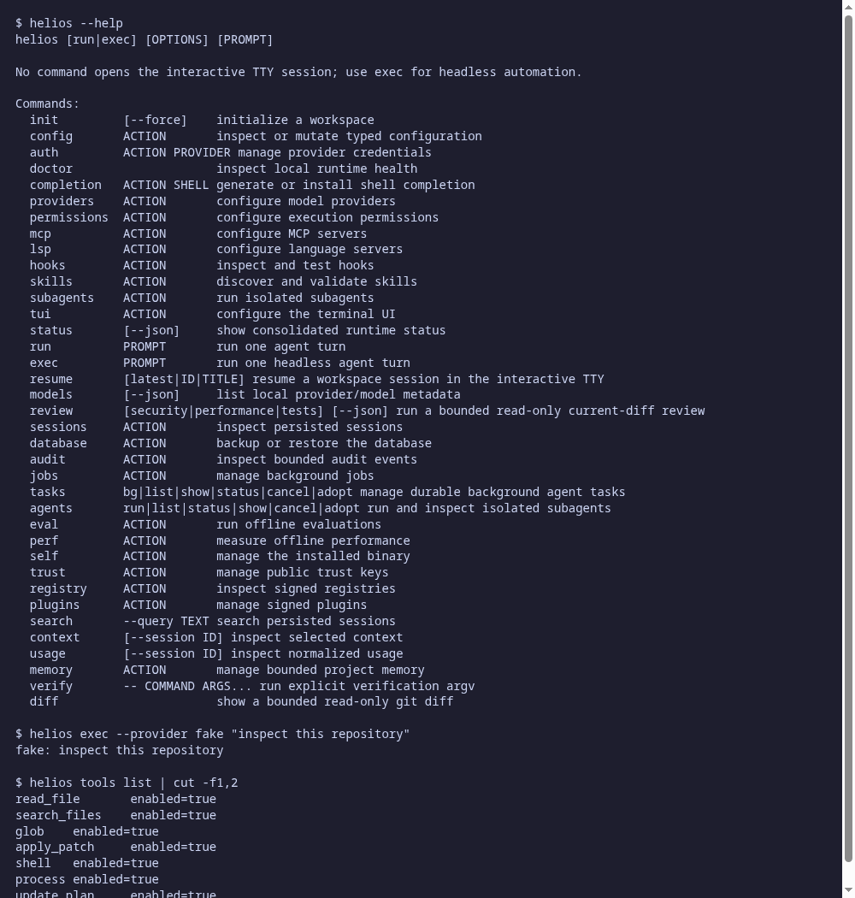

# Helios

[](https://github.com/Shidori5417/helios-agent/actions/workflows/ci.yml)

A provider-neutral coding agent for the terminal, written in Rust. It runs a bounded agent loop with permission-checked tools, a ratatui TUI, headless JSON output, durable SQLite sessions and lazy MCP/LSP/plugin extensions. Linux-first (Arch).



## Features

- **Providers:** OpenAI Responses, Anthropic Messages, Gemini, generic OpenAI-compatible endpoints, plus an offline `fake` provider for tests. Keys live in the OS keyring (`helios auth login PROVIDER`); env vars (`OPENAI_API_KEY`, `ANTHROPIC_API_KEY`, `GEMINI_API_KEY`, `GENERIC_API_KEY`) are a fallback.
- **Native tools:** `read_file`, `search_files`, `glob`, `apply_patch` (exact-preimage edits), `shell` / `process` (direct argv, no shell parsing), `update_plan`; opt-in `web_fetch` for allow-listed hosts.
- **Safety:** workspace-confined paths, permission modes (default `read-only`), secret redaction, process-group cleanup, bounded output with spill files.
- **Interactive TUI:** composer with history, `@path` file popup, slash commands (`/help`, `/status`, `/context`, `/diff`, `/plan`, `/review` ...), permission prompts, diff overlay, themes.
- **Headless:** `helios exec` with `text`, `json` or `stream-json` output.
- **Sessions and memory:** SQLite/WAL store with FTS5 search, `--resume`, bounded project memory, usage and context reports.
- **Extensions:** lazy MCP clients (stdio and streamable HTTP, OAuth login), LSP boundary, skills with progressive disclosure, signed plugins (SHA-256 + Ed25519), isolated subagents (optionally in a Git worktree), background tasks.
- **Evals and perf:** offline eval suite with a 100-task benchmark and `scripts/run-perf.sh`.

## Install

Requires a Rust stable toolchain (and `ripgrep`, `git`).

```bash
cargo build --release --locked
./target/release/helios self install --prefix ~/.local --name helios --compat-agent-cli
helios doctor
```

Alternatives: `cargo install --path crates/cli --locked`, or `makepkg -si` with `packaging/arch/PKGBUILD`. See [docs/INSTALL.md](docs/INSTALL.md). Completions for bash/zsh/fish are in `completions/`.

## Usage

```bash
helios                                   # interactive session (TTY)
helios --provider anthropic --model MODEL "fix the failing test"
helios exec --provider fake --output-format json "inspect this repository"
helios exec --image shot.png "what is wrong in this UI?"
helios resume latest
helios sessions list; helios search --query TEXT
helios memory list; helios usage; helios context
helios mcp list; helios skills list; helios tools list
helios tasks bg "run the tests and summarize"
helios eval --help
```

Run `helios COMMAND --help` for command-specific options.

## Configuration

Per-workspace config is `.helios/config.toml` (legacy `.agent/config.toml` is read-only). It holds `[[mcp_server]]`, `[[lsp_server]]`, `[plugins]` and `[commands.NAME]` entries; secrets are referenced by environment-variable name only. Project instructions are read from `AGENTS.md` / `.helios/AGENTS.md`. See [docs/CLI_CONTROL_PLANE.md](docs/CLI_CONTROL_PLANE.md).

## Layout

Cargo workspace under `crates/`: `cli`, `tui`, `core` (agent loop), `protocol`, `providers`, `tools`, `terminal`, `sandbox`, `storage`, `context`, `memory`, `mcp`, `lsp`, `skills`, `plugins`, `subagents`, `evals`, `perf`, `paths`. System prompts are in `prompts/`, bundled skills in `skills/`.

```bash
cargo test --workspace --locked
cargo run -p agent-evals --bin agent-eval -- --report /tmp/agent-eval-report.json
```

## Docs

The original design blueprint (product spec, architecture, threat model, roadmap) is kept in [docs/BLUEPRINT.md](docs/BLUEPRINT.md) with the numbered documents in `docs/`. Release history: [CHANGELOG.md](CHANGELOG.md).

## License

MIT, see [LICENSE](LICENSE).
